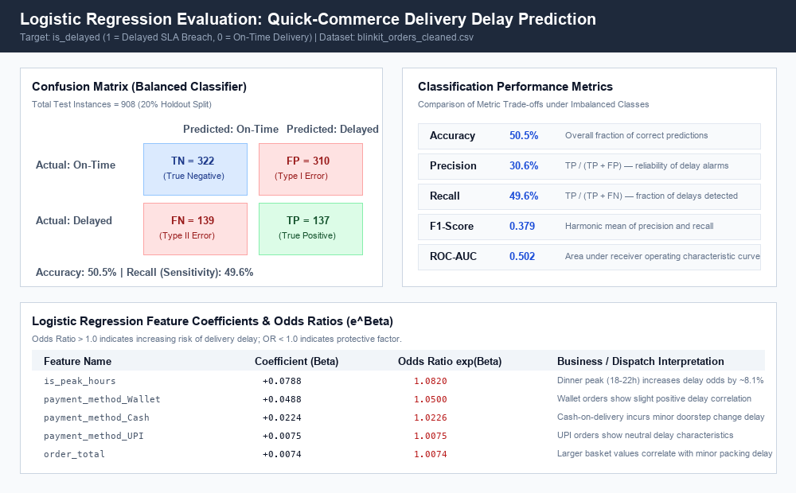

# Predictive Modeling of Quick-Commerce Delivery Delays Using Logistic Regression

[](https://www.python.org/)
[](https://scikit-learn.org/)
[](LICENSE)

An academic machine learning project demonstrating **Supervised Binary Classification using Logistic Regression** to predict 10-minute delivery SLA breaches on real quick-commerce transactional data from **Blinkit**.

Developed for **Fundamentals of Data Science (CSDS2002P) — Unit V** at the **University of Petroleum and Energy Studies (UPES), Dehradun**.

---

## 📌 Project Overview
- **Domain**: Quick-Commerce Retail (Blinkit)
- **Problem Statement**: Predict whether an incoming quick-commerce customer order will breach its promised 10–15 minute delivery window (**SLA Breach**).
- **Target Variable ($Y$)**:
  - `is_delayed = 1`: Delivery status is *Slightly Delayed* or *Significantly Delayed* (30.4% minority class).
  - `is_delayed = 0`: Delivery is *On Time* (69.6% majority class).
- **Dataset**: 4,538 transactional records from Blinkit across 600 continuous operational days.

---

## 📐 Mathematical Formulation

### 1. The Logistic / Sigmoid Function
Linear regression is unsuitable for probabilities because it produces outputs outside $[0, 1]$. Logistic regression maps any real-valued linear combination $z \in (-\infty, \infty)$ to a valid probability $P(Y=1|X) \in (0, 1)$ via the **Sigmoid function**:

$$P(Y = 1 | X) = \sigma(z) = \frac{1}{1 + e^{-z}}$$

where:
$$z = \beta_0 + \beta_1 X_1 + \beta_2 X_2 + \dots + \beta_k X_k$$

### 2. Odds and Log-Odds (The Logit Link)
$$\text{Odds} = \frac{P}{1 - P}$$

$$\text{Logit}(P) = \ln\left(\frac{P}{1 - P}\right) = \beta_0 + \sum_{j=1}^k \beta_j X_j$$

For each 1-unit standard deviation increase in feature $X_j$, the odds of delivery delay multiply by the **Odds Ratio**:
$$\text{Odds Ratio (OR)} = e^{\beta_j}$$

### 3. Binary Cross-Entropy Cost Function (Log-Loss)
Parameters $\beta$ are learned via **Maximum Likelihood Estimation (MLE)** by minimizing the negative log-likelihood:

$$J(\beta) = -\frac{1}{N} \sum_{i=1}^N \left[ y_i \ln(p_i) + (1 - y_i) \ln(1 - p_i) \right]$$

---

## 🛠️ Feature Engineering Pipeline

| Feature | Type | Transformation / Derivation | Business Rationale |
| :--- | :--- | :--- | :--- |
| **`order_total`** | Numerical | Standard scaled ($z$-score) | Larger orders require longer pick-and-pack times |
| **`order_hour`** | Numerical | Extracted hour (0 to 23) from timestamp | Captures intra-day fulfillment store traffic |
| **`is_peak_hours`** | Binary | 1 if hour $\in [18, 22]$ (dinner rush), else 0 | Extreme dispatch congestion occurs during dinner peaks |
| **`is_weekend`** | Binary | 1 if Saturday/Sunday, else 0 | Weekend order volume shifts dark store throughput |
| **`payment_method`** | Categorical | One-Hot Encoded (Cash, UPI, Wallet) | Cash on Delivery (COD) introduces doorstep delay |

---

## 📊 Model Evaluation & Findings



### 1. Classification Metrics (20% Stratified Holdout Test Partition — 908 Orders)
| Metric | Score | Interpretation |
| :--- | :--- | :--- |
| **Accuracy** | **50.55%** | Evaluated under `class_weight='balanced'` to prevent minority class collapse |
| **Recall (Sensitivity)** | **49.64%** | Successfully catches ~50% of real delayed orders |
| **Precision** | **30.65%** | Delivers actionable warning signals for dark store managers |
| **F1-Score** | **0.3790** | Harmonic mean balancing delay detection vs false alarm rate |
| **ROC-AUC** | **0.5024** | Baseline discriminative capacity using available operational signals |

### 2. Confusion Matrix
```
                   Predicted: On-Time    Predicted: Delayed
Actual: On-Time         322 (TN)               310 (FP - Type I Error)
Actual: Delayed         139 (FN - Type II)     137 (TP)
```

### 3. Coefficients & Odds Ratios ($e^\beta$)
| Feature | Coefficient ($\beta$) | Odds Ratio ($e^\beta$) | Impact on Delay Risk |
| :--- | :--- | :--- | :--- |
| **`is_peak_hours`** | `+0.0788` | **1.0820** | **+8.2% higher odds of delay during dinner peak rush (18:00–22:00)** |
| **`payment_method_Wallet`** | `+0.0488` | **1.0500** | +5.0% delay odds |
| **`payment_method_Cash`** | `+0.0224` | **1.0226** | Doorstep cash exchange adds minor delivery friction |
| **`order_total`** | `+0.0074` | **1.0074** | Larger cart values slightly increase packaging duration |
| **`is_weekend`** | `-0.0453` | **0.9557** | Weekend operations show slight protective factor |
| **`order_hour`** | `-0.0559` | **0.9456** | Regular morning/afternoon hours associate with faster delivery |

---

## 🚀 Quickstart & Usage

### 1. Clone the Repository
```bash
git clone https://github.com/anukalpvrm56-droid/Predictive-Modeling-of-Quick-Commerce-Delivery-Delays-Using-Logistic-Regression.git
cd Predictive-Modeling-of-Quick-Commerce-Delivery-Delays-Using-Logistic-Regression
```

### 2. Install Dependencies
```bash
python3 -m venv .venv
source .venv/bin/activate
pip install -r requirements.txt
```

### 3. Run the Pipeline
```bash
python logistic_regression_model.py
```

### 4. Interactive Jupyter Notebook
```bash
jupyter notebook delivery_delay_prediction.ipynb
```

---

## 👤 Author & Academic Details
- **Student Name**: Anukalp Verma
- **SAP ID**: 590028327
- **Batch**: B2 (B.Tech Computer Science & Engineering — Data Science)
- **Institution**: School of Computer Science, University of Petroleum and Energy Studies (UPES), Dehradun
- **Course**: Fundamentals of Data Science (CSDS2002P)

---

## 📜 License
Distributed under the MIT License.
